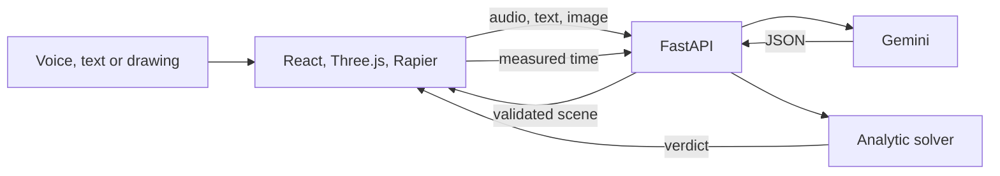

# Chalk

**Describe a physics experiment out loud. Change it by voice. Check the result against the formula.**

Chalk turns what a teacher says or draws into a 3D physics experiment the class can change live. Students predict first, then watch a physics engine run the experiment, and code compares the measured result with the analytic solution.

🥉 **3rd place, Track 02: Multimodal & Human-Centric AI**, at [Halloween at Imperial: Gemini Edition](https://luma.com/p41k1z3g) (2026).

## The moment to try

1. Say: *"A ball rolls down a 30 degree slope, 4 metres long."*
2. Predict: *"I think a heavier ball gets there faster."*
3. Say: *"Double the mass."* and run it again.

The time stays at about 1.51 s, because mass is not in the formula for a rolling ball. Do the same with a mass on a spring and the period changes, from 1.28 s to 1.81 s when the mass doubles from 5 kg to 10 kg.

## The model proposes, code checks

The model never decides whether a result is correct.

| Step | Who does it | How |
|---|---|---|
| Speech to text | `gemini-3.8-flash` | Recorded audio, English only. Silence is never sent |
| Speech or drawing to a scene | `gemini-4-argon` | Structured output, validated against a strict schema |
| "What if…" changes | `gemini-4-argon` | Only allowed fields, with range checks |
| Measuring the experiment | Rapier physics engine | Runs in the browser and knows nothing about the formula |
| Expected result | Python solver | Closed-form formulas |
| **Verdict** | **Code** | `match` within a 2% tolerance, otherwise `mismatch` |
| Explanation | `gemini-4-argon` | Uses only the numbers it is given |

If the input is not a supported physics problem, Chalk says so instead of guessing. If the check cannot run, the screen says "Could not check".

## What is verified

| Scenario | Measured in Rapier and checked by code |
|---|---|
| Ball or block on an incline, including slip and friction that holds a block still | Yes |
| Vertical spring oscillator | Yes |
| Other scenes, such as projectile, collision, cloud chamber and generated apparatus | No. These are visual previews |

Rapier agrees with the formulas within 1% for a rolling ball at 15–70° on 1–8 m slopes. Spring and block cases are covered within the 2% tolerance by `frontend/src/physics/rapierMeasure.test.ts`.

## Run it

You need Python 3.11, Node 22.12 or newer, Chrome and a Gemini API key.

```bash
# Backend
cd backend
python3 -m venv .venv
.venv/bin/pip install -r requirements.txt
export GEMINI_API_KEY=your_key
.venv/bin/python -m uvicorn app.main:app --port 8000
```

```bash
# Frontend, in a second terminal
cd frontend
npm ci
npm run dev
```

Open http://localhost:5173. Press the microphone, speak, then press it again. Typing works too.

Test images are in `fixtures/drawings/`.

## Tests

```bash
cd backend && .venv/bin/python -m pytest -q
cd frontend && npx vitest run
```

## How it fits together



The API key stays on the backend. Images are re-encoded to remove metadata, and logs contain no images or keys.

## Limitations

- Mechanics only, in an idealised model with no air resistance. Chalk adds to a lab rather than replacing one.
- Voice input is English only. Text input also understands Russian.
- Hand-drawn angles without a written value are estimates, so Chalk shows what it read before you run it.
- Built in five hours as a prototype. Accounts and classroom workspaces are the next step, not part of this version.

See also [CAD_MODELS.md](CAD_MODELS.md) and the [architecture notes](docs/ARCHITECTURE.md).
