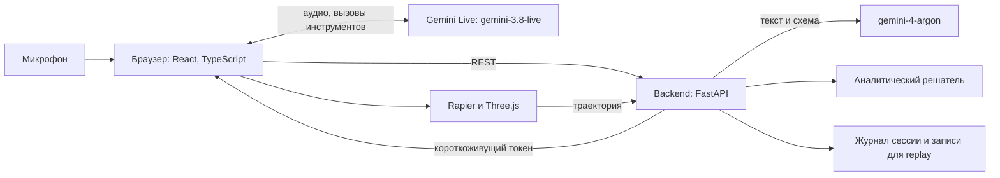

# Chalk: архитектура

Статус: 31.10.2026, 13:40. Основной ввод: диктовка (`gemini-3.5-transcribe-live`). Голосового ассистента нет, ответы показываются на экране. Рисунок в P1. Схема и шаги ниже обновляются вместе с клиентом диктовки; действующий контракт backend см. в `docs/sprints/sprint-2-dictation-flow.md`. Изменения контрактов обсуждаем в чате команды до кода.

## 1. Цель демо

Судья описывает опыт голосом: «Шар катится по склону 30 градусов» — и спрашивает: «А если масса вдвое больше?» Ассистент сначала спрашивает прогноз, затем запускает 3D-сцену и показывает, совпала ли симуляция с формулой.

Главный пример: шар на наклонной плоскости. В идеальной модели ускорение не зависит от массы: `a = (5/7) g sin(θ)` при качении без проскальзывания. Интуиция многих подсказывает обратное, и в этом весь момент демо.

**Принцип: модель предлагает, код проверяет.** Модель не пишет исполняемый код и не объявляет результат верным. Она возвращает данные по схеме и объясняет результат.

## 2. Компоненты

| Слой | Технология | Почему |
|---|---|---|
| Интерфейс | React, TypeScript, Vite | Быстрый старт, типы |
| 3D | Three.js, Rapier (`@dimforge/rapier3d-compat`) | Физика в браузере без нагрузки на сервер |
| API | Python 3.11, FastAPI, Pydantic | Схемы и OpenAPI из коробки |
| Рассуждения | `gemini-4-argon`, structured output | Чтение рисунка в строгий JSON |
| Голос | `gemini-3.8-live`, прямое подключение браузера | Минимальная задержка |
| Хранение | Файлы JSONL, без базы данных | Аккаунты и история на демо не нужны |

## 3. Основной сценарий

1. Браузер запрашивает `POST /api/v1/sessions` и получает `session_id` и короткоживущий токен Live.
2. Браузер подключается к Live и передаёт звук с микрофона. Включены сжатие контекста и возобновление сессии.
3. Live вызывает инструмент `set_scene(description)` с описанием опыта. Браузер отправляет текст в `POST /api/v1/scenes/analyze` (поле `text`). Вызов неблокирующий: ответ Argon идёт 4–12 с, ассистент в это время говорит.
4. Backend получает от Argon `SceneSpec`, проверяет его по схеме и границам и возвращает браузеру. Live передаёт результат как ответ инструмента.
5. На экране показываем распознанное: тип задачи, значения, допущения. Пользователь подтверждает голосом или кнопкой.
6. Ассистент спрашивает прогноз. Прогноз сохраняем до запуска.
7. Браузер запускает Rapier с фиксированным шагом 1/120 с и отправляет траекторию в `POST /api/v1/verify`.
8. Backend считает аналитический ответ и возвращает `verdict`.
9. Результат передаём в Live как ответ инструмента. Ассистент объясняет его, опираясь на числа.
10. На вопрос «а если…» Live вызывает `update_scene`, изменения проверяются backend, цикл идёт с шага 6.

### Состояния интерфейса

`idle → watching → recognizing → confirming → predicting → simulating → verifying → explaining`, из `explaining` снова в `predicting`. Из любого состояния возможен `error` с понятным следующим действием.

## 4. API v1

| Метод | Назначение | Ответ |
|---|---|---|
| `GET /healthz` | Проверка работы | `{status}` |
| `POST /api/v1/sessions` | Новая сессия | `{session_id, live_token, expires_at}` |
| `POST /api/v1/scenes/analyze` | Текст (основной путь) или изображение в `SceneSpec` | `{scene, trace_id}` |
| `POST /api/v1/scenes/patch` | Изменить параметры | `{scene}` |
| `POST /api/v1/verify` | Сверить траекторию | `{verdict, expected, measured, error_pct, tolerance_pct}` |
| `GET /api/v1/replay/{id}` | Запись для запасного режима | Записанная сессия |

Формат ошибки единый: `{code, message, trace_id}`. Типы TypeScript генерируются из OpenAPI (`openapi-typescript`), вручную их не дублируем. Источник правды по сцене: `contracts/scene_spec.schema.json`.

Инструменты Live: `set_scene(description)`, `update_scene(field, value)`, `record_prediction(text)`, `run_simulation()`.

## 5. Проверка

Вердикт выдаёт только код.

| Сценарий | Сравниваем | Формула |
|---|---|---|
| Плоскость, блок | Время до конца | `a = g(sinθ − μcosθ)`, `t = √(2L/a)`; если `tanθ ≤ μ`, блок не движется |
| Плоскость, шар | Время до конца | `a = (5/7) g sinθ`, при достаточном трении |
| Снаряд | Дальность и время полёта | Кинематика без сопротивления воздуха |
| Маятник | Период | Численное решение при больших углах |
| Столкновение | Скорости после удара | Законы сохранения с коэффициентом восстановления |

- Допуск на старте 2%. Кирилл уточняет его по результатам тестов для каждого сценария.
- `verdict`: `match`, `mismatch` или `not_applicable`. Расхождение показываем, а не скрываем.
- Настройки трения и контакта в Rapier нужно проверить на эталонных задачах. Это главный технический риск.

## 6. Безопасность

- `GEMINI_API_KEY` только на backend. В браузер попадает лишь короткоживущий токен с ограниченным сроком и моделью.
- Изображения: только JPEG и PNG, до 5 МБ, проверка содержимого, перекодирование для удаления метаданных. На диск не сохраняем без явного согласия.
- Текст на рисунке считаем данными, а не инструкциями. Ответ модели проходит строгую схему, лишние поля отклоняются, исполняемого кода от модели нет.
- Текст из голоса такой же недоверенный ввод, как рисунок: до 2000 символов, через схему.
- `update_scene` меняет только разрешённые поля и в пределах схемы.
- CORS только для известных адресов, ограничение частоты запросов, HTTPS вне localhost (без него браузер не даст камеру).
- В логах нет ключей, токенов и изображений. Сканирование секретов в CI и перед открытием репозитория.

## 7. Качество и работа с кодом

- Монорепозиторий: `backend/`, `frontend/`, `contracts/`, `fixtures/`, `docs/`.
- Короткие ветки `имя/задача`, PR в `main`, один проверяющий. Срочные правки заморозки только с согласия капитана.
- CI: `ruff`, `pytest`, `tsc`, `vitest`, сборка, `gitleaks`.
- Тесты: решатель на эталонных значениях, API на контрактах, набор голосовых фраз с ожидаемым `SceneSpec`, один сквозной тест Playwright.
- Конфигурация только через переменные окружения, логи в JSON с `trace_id`.
- `REPLAY_MODE=true` запускает записанный прогон без сети.

**Сознательно не делаем:** аккаунты, базу данных, Kubernetes, микросервисы, произвольные сцены.

## 8. Запуск

Основной путь: backend и frontend локально на ноутбуке для сцены, при наличии времени frontend на Vercel и backend на Cloud Run или Render. Интернет с телефона и запись прогона как страховка.

## 9. Ответственность

| Человек | Владеет | Результат |
|---|---|---|
| **Николай**, backend и данные | `analyze`, `patch`, промпт Argon и Live, решатель, журнал, replay, набор фраз | Голос превращается в проверенный `SceneSpec`, замеряется точность |
| **Дамир**, backend и безопасность | Каркас FastAPI, `sessions` и токены Live, загрузка файлов, лимиты, CORS, ошибки, CI, деплой | Безопасный работающий API |
| **Кирилл**, frontend, визуал, физика | 3D-сцены, Rapier, график «формула и симуляция», эталонные задачи, ревью формул | Сцены сходятся с формулой в пределах допуска |
| **Кристина**, frontend | Каркас приложения, клиент Live (микрофон, звук, прерывание, инструменты), состояния, подтверждение, прогноз, панель вердикта | Весь сценарий управляется голосом и кнопками |

Стыки: Николай и Кирилл согласуют физику, Николай и Кристина ответы API, Дамир и Кристина токен Live, Кирилл и Кристина компонент `<Scene spec onTrajectory />`.

## 10. Гейты

| Время | Что должно работать |
|---|---|
| 13:00 | Контракты приняты, заглушка API, сцена «шар на плоскости» с ручными данными, голос Live в браузере |
| 14:00 | Уродливая сквозная версия: голос, JSON, симуляция, вердикт. Запись чернового прогона |
| 14:45 | Голосовой цикл с прогнозом и «а если», минимум шар и блок на плоскости |
| 15:15 | Заморозка функций |
| 15:45 | Сдача, репозиторий открыт, проверен без входа в аккаунт |

Обед по очереди, без общей остановки. Если к 14:45 голос нестабилен, управление идёт кнопками, а голос остаётся только для объяснения. Первыми вырезаем маятник и столкновение.
