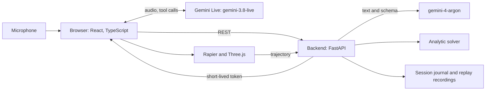

# Chalk: architecture

Status: 31 October 2026, 13:40. Primary input: dictation (`gemini-3.5-transcribe-live`). There is no voice assistant, and answers are shown on screen. Drawing is in P1. The diagram and steps below are being updated along with the dictation client; for the current backend contract, see `docs/sprints/sprint-2-dictation-flow.md`. Contract changes are discussed in the team chat before any code is written.

> **Note:** this is the plan written on the day of the hackathon, kept as a record. The final build differs in places: for example, voice is recorded in the browser and transcribed by the backend. See the [README](../README.md) for how Chalk works now.

## 1. Demo goal

A judge describes an experiment by voice: "A ball rolls down a 30 degree slope", then asks: "What if the mass is doubled?" The assistant first asks for a prediction, then runs the 3D scene and shows whether the simulation matched the formula.

Main example: a ball on an inclined plane. In the ideal model, acceleration does not depend on mass: `a = (5/7) g sin(θ)` when rolling without slipping. Many people's intuition says otherwise, and that is the whole point of the demo.

**Principle: the model proposes, code checks.** The model does not write executable code and does not declare a result correct. It returns data that follows a schema and explains the result.

## 2. Components

| Layer | Technology | Why |
|---|---|---|
| Interface | React, TypeScript, Vite | Fast start, types |
| 3D | Three.js, Rapier (`@dimforge/rapier3d-compat`) | Physics in the browser with no server load |
| API | Python 3.11, FastAPI, Pydantic | Schemas and OpenAPI out of the box |
| Reasoning | `gemini-4-argon`, structured output | Reads a drawing into strict JSON |
| Voice | `gemini-3.8-live`, direct browser connection | Lowest latency |
| Storage | JSONL files, no database | The demo needs no accounts or history |

## 3. Main flow

1. The browser calls `POST /api/v1/sessions` and receives a `session_id` and a short-lived Live token.
2. The browser connects to Live and streams microphone audio. Context compression and session resumption are on.
3. Live calls the `set_scene(description)` tool with a description of the experiment. The browser sends the text to `POST /api/v1/scenes/analyze` (the `text` field). The call is non-blocking: Argon takes 4–12 s to respond, and the assistant keeps talking during that time.
4. The backend receives a `SceneSpec` from Argon, validates it against the schema and limits, and returns it to the browser. Live passes the result back as the tool response.
5. The screen shows what was recognised: problem type, values and assumptions. The user confirms by voice or with a button.
6. The assistant asks for a prediction. The prediction is saved before the run.
7. The browser runs Rapier with a fixed 1/120 s timestep and sends the trajectory to `POST /api/v1/verify`.
8. The backend calculates the analytic answer and returns a `verdict`.
9. The result is passed to Live as a tool response. The assistant explains it using the numbers.
10. On a "what if…" question, Live calls `update_scene`, the backend validates the changes, and the cycle continues from step 6.

### Interface states

`idle → watching → recognizing → confirming → predicting → simulating → verifying → explaining`, then from `explaining` back to `predicting`. Any state can move to `error`, with a clear next action.

## 4. API v1

| Method | Purpose | Response |
|---|---|---|
| `GET /healthz` | Health check | `{status}` |
| `POST /api/v1/sessions` | New session | `{session_id, live_token, expires_at}` |
| `POST /api/v1/scenes/analyze` | Text (main path) or image to `SceneSpec` | `{scene, trace_id}` |
| `POST /api/v1/scenes/patch` | Change parameters | `{scene}` |
| `POST /api/v1/verify` | Check a trajectory | `{verdict, expected, measured, error_pct, tolerance_pct}` |
| `GET /api/v1/replay/{id}` | Recording for fallback mode | Recorded session |

All errors use one format: `{code, message, trace_id}`. TypeScript types are generated from OpenAPI (`openapi-typescript`) and are not duplicated by hand. The source of truth for scenes is `contracts/scene_spec.schema.json`.

Live tools: `set_scene(description)`, `update_scene(field, value)`, `record_prediction(text)`, `run_simulation()`.

## 5. Verification

Only code gives the verdict.

| Scenario | What is compared | Formula |
|---|---|---|
| Incline, block | Time to the end | `a = g(sinθ − μcosθ)`, `t = √(2L/a)`; if `tanθ ≤ μ`, the block does not move |
| Incline, ball | Time to the end | `a = (5/7) g sinθ`, with enough friction |
| Projectile | Range and flight time | Kinematics with no air resistance |
| Pendulum | Period | Numerical solution at large angles |
| Collision | Velocities after impact | Conservation laws with a coefficient of restitution |

- The starting tolerance is 2%. KirilBoiko refines it for each scenario based on test results.
- `verdict`: `match`, `mismatch` or `not_applicable`. A mismatch is shown, not hidden.
- Rapier's friction and contact settings must be checked against reference problems. This is the main technical risk.

## 6. Security

- `GEMINI_API_KEY` stays on the backend only. The browser receives only a short-lived token limited by time and model.
- Images: JPEG and PNG only, up to 5 MB, with content checks and re-encoding to remove metadata. They are not saved to disk without explicit consent.
- Text in a drawing is treated as data, not instructions. The model's response goes through a strict schema, extra fields are rejected, and the model produces no executable code.
- Text from voice is untrusted input, just like a drawing: up to 2000 characters, through the schema.
- `update_scene` changes only allowed fields, within the schema's limits.
- CORS only for known origins, rate limiting, and HTTPS outside localhost (browsers will not allow camera access without it).
- Logs contain no keys, tokens or images. Secrets are scanned in CI and before the repository is made public.

## 7. Quality and ways of working

- Monorepo: `backend/`, `frontend/`, `contracts/`, `fixtures/`, `docs/`.
- Short `name/task` branches, PRs into `main`, one reviewer. Urgent changes during the freeze need the captain's agreement.
- CI: `ruff`, `pytest`, `tsc`, `vitest`, build, `gitleaks`.
- Tests: solver against reference values, API against contracts, a set of voice phrases with expected `SceneSpec` values, one end-to-end Playwright test.
- Configuration through environment variables only, JSON logs with `trace_id`.
- `REPLAY_MODE=true` runs a recorded session with no network.

**Deliberately not building:** accounts, a database, Kubernetes, microservices, arbitrary scenes.

## 8. Running it

Main path: backend and frontend locally on the stage laptop. If time allows, frontend on Vercel and backend on Cloud Run or Render. Phone internet and a recorded run as backup.

## 9. Ownership

| Person | Owns | Outcome |
|---|---|---|
| **cprite**, backend and data | `analyze`, `patch`, Argon and Live prompts, solver, journal, replay, phrase set | Voice becomes a validated `SceneSpec`, with accuracy measured |
| **Dart6y**, backend and security | FastAPI skeleton, `sessions` and Live tokens, file uploads, limits, CORS, errors, CI, deployment | A secure, working API |
| **KirilBoiko**, frontend, visuals, physics | 3D scenes, Rapier, "formula and simulation" chart, reference problems, formula review | Scenes match the formula within tolerance |
| **kwerui**, frontend | App skeleton, Live client (microphone, audio, interruption, tools), states, confirmation, prediction, verdict panel | The whole flow works by voice and buttons |

Interfaces: cprite and KirilBoiko agree on physics, cprite and kwerui on API responses, Dart6y and kwerui on the Live token, KirilBoiko and kwerui on the `<Scene spec onTrajectory />` component.

## 10. Gates

| Time | What must work |
|---|---|
| 13:00 | Contracts agreed, API stub, "ball on incline" scene with manual data, Live voice in the browser |
| 14:00 | Rough end-to-end version: voice, JSON, simulation, verdict. A draft run recorded |
| 14:45 | Voice loop with prediction and "what if", at minimum a ball and a block on an incline |
| 15:15 | Feature freeze |
| 15:45 | Submission, repository public and checked without signing in |

Lunch in turns, with no full stop. If voice is unstable by 14:45, control moves to buttons and voice is used only for the explanation. Pendulum and collision are the first to be cut.
